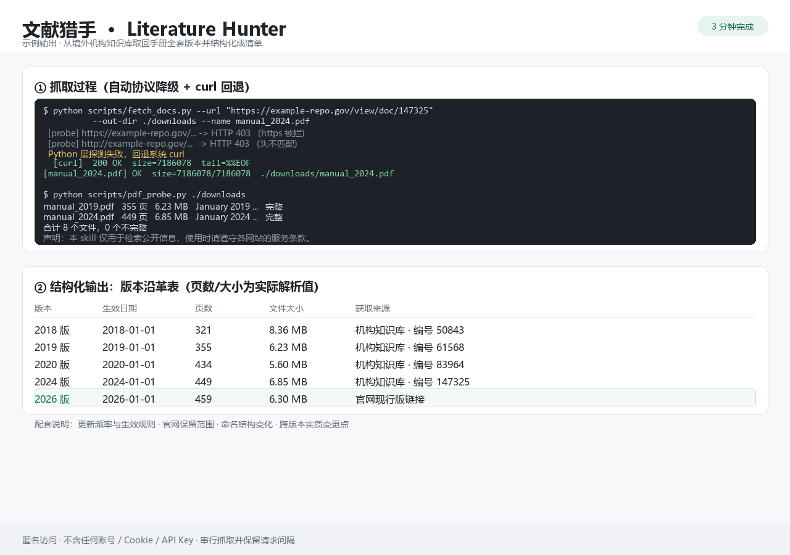

# 文献猎手 · Literature Hunter

> **扒外网文献太慢？这个 skill 帮你 3 分钟搞定。**
> 官网被拦、下载一半断掉、历史版本找不回、最后得到一堆散链接没法用——
> 这些坑它都替你踩过了。把「检索 → 筛选 → 抓取 → 结构化输出」固化成一套流程，装上就用。



## 它解决什么问题

| 痛点 | 文献猎手的做法 |
|---|---|
| 官方站点访问被拦（403 / 超时） | 自动降级路径：协议降级 → 请求头轮换 → 系统 curl 回退，命中即停 |
| 下载到一半文件损坏 | 断点续传（服务器不支持范围请求时自动整份重下）+ PDF 尾部标记（`%%EOF`）自动校验，不完整就补齐 |
| 站点只挂最新版，历史版本找不回 | 机构知识库编号、年份目录命名规律、镜像站点三路查找 |
| 页数、版本信息缺失或对不上 | 不照抄站点标称，本地解析 PDF 拿真实页数与首页版本标记 |
| 检索结果一堆散链接没法交付 | 固定三种结构化模板：版本沿革表 / 批次清单表 / 单文档摘要卡 |

## 安装

把整个目录放进 WorkBuddy 的技能目录：

```bash
# macOS / Linux
git clone https://github.com/XYSM99/literature-hunter.git \
    ~/.workbuddy/skills/literature-hunter

# Windows PowerShell（注意：PowerShell 不展开 ~，要写完整路径）
git clone https://github.com/XYSM99/literature-hunter.git \
    C:\Users\<你的用户名>\.workbuddy\skills\literature-hunter
```

也可以直接下载 ZIP 解压到上面的目录。重启会话即可触发。触发语示例：

- 「帮我查某某机构某某手册有几个版本，并把原文下载下来」
- 「把这份指南的历年版本整理成对照表」
- 「某某站点打不开 / 下载失败，帮我想办法拿到原文」

## 用法（三步）

```bash
# 1) 抓取：自动协议降级 + 断点续传 + 完整性校验
python scripts/fetch_docs.py --url "<文档URL>" --out-dir ./downloads

# 2) 核验：批量提取页数 / 大小 / 首页版本标记 / 完整性
python scripts/pdf_probe.py ./downloads

# 3) 结构化输出：按 references/output-format.md 套模板，交付清单或对照表
```

批量任务支持清单文件与多候选镜像：

```bash
python scripts/fetch_docs.py --list urls.txt --out-dir ./downloads
python scripts/fetch_docs.py --mirror-file mirrors.txt --out-dir ./downloads
```

脚本仅依赖 Python 3.8+ 与 `pypdf`（校验用），以及系统自带的 `curl`（回退用）。无需安装任何浏览器自动化或付费工具。

## Skill 里有什么

```
literature-hunter/
├── SKILL.md                        # 工作流主文件（检索→筛选→抓取→输出）
├── references/
│   ├── sources.md                  # 按领域分类的官方源清单与定位语法
│   ├── access-playbook.md          # 受限访问的降级路径（本 skill 的核心经验）
│   ├── filtering.md                # 可信度分级、版本识别、去重规则
│   └── output-format.md            # 三类结构化输出模板
├── scripts/
│   ├── fetch_docs.py               # 匿名抓取（协议降级/头轮换/curl 回退/续传）
│   └── pdf_probe.py                # PDF 元信息提取与完整性校验
└── assets/
    └── sample-output.png           # 示例输出截图
```

**只分享方法，不打包内容。** 仓库里没有任何文献本体、站点镜像包或抓取缓存——全部是可复用的流程、语法与脚本。

## 隐私与安全

- **不含任何登录态**：无账号、无 Cookie、无 Token、无 API Key，全部匿名只读
- **不绕过付费墙**：不登录、不撞库、不抓取需授权内容
- **发布前自检**：每次提交前运行下面的检查，确保没有凭据残留

```bash
# 自检：扫描是否残留疑似密钥/令牌/个人路径
grep -rInE "(api[_-]?key|token|cookie|authorization|bearer|password)[\"' ]*[:=]" . || echo "clean"
```

## 边界与声明

**本 skill 仅用于检索公开信息，使用时请遵守各网站的服务条款。**

- 抓取保持串行并保留请求间隔，不对目标站点造成压力
- 遇到付费墙、登录墙、明确的反爬声明时停止，转向其他合法公开来源
- 抓取成果仅用于个人学习与研究，再分发请遵循原文的版权与许可条款

## License

MIT
